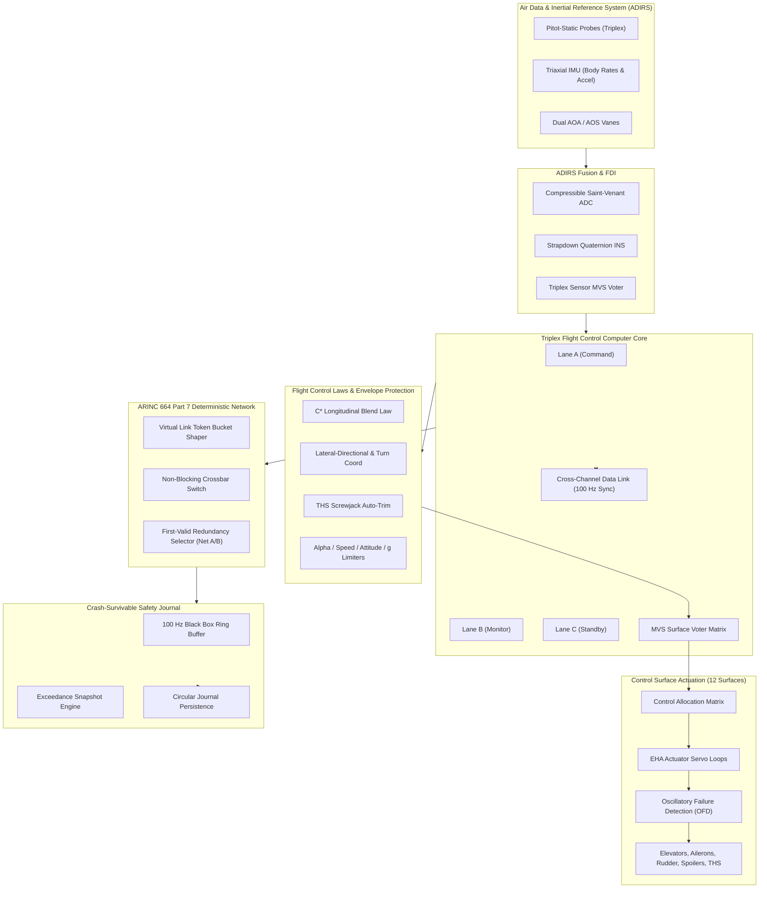

# Elevon

```
 _______ ___     _______ ___     _______ __   __ 
|       |   |   |       |   |   |       |  |_|  |
|    ___|   |   |    ___|   |   |   _   |       |
|   |___|   |   |   |___|   |   |  | |  |       |
|    ___|   |___|    ___|   |___|  |_|  |       |
|   |___|       |   |___|       |       | ||_|| |
|_______|_______|_______|_______|_______|_|   |_|
```

> **Triple-Modular Redundant (TMR) Fly-by-Wire Flight Control Computer, ARINC 664 Part 7 (AFDX) Deterministic Avionics Network, and Dynamic Flight Envelope Protection System in Cangjie with C17 Hardware Fastpath Acceleration**

[](https://github.com/Aneesh495/elevon/actions/workflows/ci.yml)
[](LICENSE)
[](cjpm.toml)
[](https://en.wikipedia.org/wiki/C17_(C_standard_revision))
[](tools/lint_no_em_dash.py)

---

## Overview

**Elevon** is a production-grade, deterministic Fly-by-Wire (FBW) Primary Flight Control Computer (FCC) and ARINC 664 Part 7 (AFDX) avionics network engine. Developed in **Cangjie** with low-overhead **C17** hardware acceleration, Elevon coordinates triple-modular redundant (TMR) computational lanes, compressible flow air data estimation (ADIRS), and dynamic flight envelope protection laws.

The architecture adheres to civil transport category requirements (FAA 14 CFR Part 25 / EASA CS-25) and DO-178C Level A / ARP4754A safety objectives:
- **Triplex Fault-Tolerant Computing**: Three hardware-isolated lanes (Command, Monitor, Standby) executing on a synchronized 100 Hz (10 ms) minor cycle with Mid-Value Selection (MVS) voting, Cross-Channel Data Links (CCDL), and Byzantine divergence latching.
- **Longitudinal C* Flight Control Law**: Airspeed-scheduled blending of normal load factor $N_z$ and pitch rate $q$ with automatic Trimmable Horizontal Stabilizer (THS) auto-trimming to maintain zero steady-state elevator aerodynamic load.
- **Hard Flight Envelope Protections**: Active High-AOA ($\alpha_{\text{prot}}$, $\alpha_{\text{floor}}$, $\alpha_{\max}$), High-Speed ($V_{\text{MO}} / M_{\text{MO}}$), bank angle attitude limiting ($67^\circ$ with positive spiral stability restore past $33^\circ$), and structural load factor limiters ($+2.5g / -1.0g$).
- **ARINC 664 Part 7 (AFDX) Network**: Deterministic switched Ethernet with Virtual Link (VL) Bandwidth Allocation Gap (BAG) traffic shaping, dual-network redundancy (Network A and Network B) with First-Valid sequence number acceptance ($0 \dots 255$), and non-blocking crossbar routing.
- **Crash-Survivable Flight Data Recorder (FDR)**: Pre-allocated circular parameter ring buffer with Castagnoli CRC-32C verification and automated high-resolution exceedance snapshot recording.

---

## Architectural Topology



---

## Technical Highlights

### 1. Longitudinal C* Flight Control Law
Modern civil fly-by-wire transports demand pitch rate $q$ at low speed for rotational flare accuracy, and normal load factor $N_z$ at high speed for flight path angle stability and turbulence rejection. Elevon dynamically blends both parameters across the airspeed envelope:

$$C^*_{\text{feedback}} = (N_z - 1.0) + \frac{V_{\text{co}}}{g_0} q$$

where crossover airspeed $V_{\text{co}} \approx 210\,\text{knots} \approx 108\,\text{m/s}$ and $g_0 = 9.80665\,\text{m/s}^2$.

- At low airspeed ($V_{\text{CAS}} \ll V_{\text{co}}$): pitch rate $q$ dominates, giving precise rotational control during flare and touchdown.
- At high airspeed ($V_{\text{CAS}} \gg V_{\text{co}}$): load factor $N_z$ dominates, providing automatic $1g$ flight path hold without pilot trim adjustments.

### 2. Triple-Modular Redundancy & Mid-Value Selection
Analog state variables and surface commands are arbitrated across Lanes A, B, and C using Mid-Value Selection (MVS):

$$\text{MVS}(v_A, v_B, v_C) = \max(\min(v_A, v_B), \min(\max(v_A, v_B), v_C))$$

If an individual lane deviates beyond threshold $\epsilon_{\text{thresh}}$ for 5 consecutive minor frames, Failure Detection and Isolation (FDI) latches the faulty lane offline and seamlessly degrades to duplex cross-check average $\frac{v_1 + v_2}{2}$.

### 3. ARINC 664 Part 7 (AFDX) Determinism
Avionics frames are regulated via token bucket traffic shapers enforcing Bandwidth Allocation Gaps ($BAG \in \{1, 2, 4, 8, 16, 32, 64, 128\}\,\text{ms}$). Frame jitter is formally bounded by:

$$J \le 40\,\mu\text{s} + \frac{\sum L_{\max}}{C} \le 500\,\mu\text{s}$$

Every packet is simultaneously dispatched across redundant Network A and Network B. Receivers utilize First-Valid selection with sequence number verification ($0 \dots 255$), guaranteeing zero application frame dropout during switch failovers or physical line cuts.

---

## Repository Layout

```
elevon/
├── .github/workflows/ci.yml       # Multi-platform continuous integration workflow
├── cjpm.toml                     # Cangjie Package Manager configuration manifest
├── Makefile                      # Standard C17 / Cangjie build and test orchestrator
├── LICENSE                       # Apache License 2.0
├── config/
│   ├── aircraft_aero.json        # Aircraft aerodynamic derivatives and mass properties
│   ├── afdx_topology.json        # AFDX Virtual Link routing and BAG configurations
│   └── fault_drills.json         # Emergency fault injection scenario parameters
├── docs/
│   ├── architecture.md           # Detailed subsystem architecture and Mermaid diagrams
│   └── flight_dynamics_theory.md # C* law derivations and Network Calculus proofs
├── include/                      # Public C17 header interfaces
│   ├── elevon.h                  # Unified master header and handle definition
│   ├── elevon_types.h            # Core avionics scalar datatypes and structs
│   ├── elevon_crc32.h            # Hardware-accelerated Castagnoli CRC-32C
│   ├── elevon_math.h             # 3D vector, matrix, and quaternion kinematics
│   ├── elevon_voter.h            # MVS and discrete 2oo3 voting engine
│   ├── elevon_adirs.h            # Compressible Saint-Venant air data computer
│   ├── elevon_actuator.h         # EHA servo dynamics and hydraulic circuit models
│   ├── elevon_afdx.h             # AFDX binary Ethernet wire framing and shaper
│   └── elevon_fdr.h              # Crash-survivable circular black box journal
├── src/
│   ├── cangjie/elevon/           # Star Language: Full Cangjie Subsystem Implementation
│   │   ├── core/                 # TMR lanes, MVS voters, CCDL, master FCC system
│   │   ├── adirs/                # ISA atmosphere, pitot calibration, IMU kinematics
│   │   ├── fcl/                  # C* law, auto-trim, lateral/directional laws, protections
│   │   ├── actuator/             # EHA servo loop, control allocation, OFD detector
│   │   ├── afdx/                 # Virtual links, Ethernet frames, redundancy, crossbar
│   │   ├── fdr/                  # Black box ring buffer, exceedance snapshot trigger
│   │   └── telemetry/            # ANSI PFD HUD, packet inspector, drill runner
│   ├── c/                        # Low-latency C17 hardware acceleration fastpath
│   │   ├── elevon_crc32.c        # CRC-32C table generation and checksum updates
│   │   ├── elevon_math.c         # Quaternion integration and Euler conversions
│   │   ├── elevon_types.c        # Status code and flight law string conversions
│   │   ├── elevon_voter.c        # Vectorized MVS voting and fault latching
│   │   ├── elevon_adirs.c        # ISA lookups and supersonic/subsonic air data
│   │   ├── elevon_actuator.c     # Slew-limited hydraulic actuator dynamics
│   │   ├── elevon_afdx.c         # Raw Ethernet / UDP frame codec and BAG shaper
│   │   ├── elevon_fdr.c          # Crash-consistent direct POSIX journal I/O
│   │   └── elevon_fcc.c          # Master C Foreign Function Interface bridge
│   └── cli/
│       └── main.c                # Unified elevon command-line interface executable
├── tests/                        # Comprehensive unit and integration verification suites
│   ├── test_voter.c              # MVS voting, skew, and Byzantine fault tests
│   ├── test_adirs.c              # Saint-Venant aerodynamics and IMU strapdown tests
│   ├── test_fcl.c                # Longitudinal C* law and envelope protection tests
│   ├── test_afdx.c               # BAG traffic shaping and Network A/B failover tests
│   ├── test_fdr.c                # Circular journal rollover and CRC recovery tests
│   ├── test_simulation.c         # 10,000-cycle full flight integration test
│   ├── test_emergency_drills.py  # Automated Python emergency scenario test runner
│   └── test_qa_typography.py    # Zero em dash repository typography invariant test
├── tools/
│   ├── lint_no_em_dash.py        # Automated typography linter enforcing no em dashes
│   ├── generate_flight_telemetry.py # Synthetic mission flight profile generator
│   └── plot_envelope.py          # Maneuvering envelope (V-n diagram) visualizer
└── benchmarks/
    └── bench_latency.c           # Minor cycle latency and real-time deadline benchmark
```

---

## Quickstart

### Prerequisites
- Clang / GCC with C17 support (`-std=c17`)
- Python 3.8+ (for integration test runner and verification tools)
- Make and standard POSIX development utilities

### Building Elevon
Compile the static library `build/libelevon.a` and the unified control binary `bin/elevon`:

```bash
make clean
make
```

### Running the Full Test Suite
Execute the entire test suite including C unit tests, 10,000-cycle simulation verification, Python integration tests, and the zero em dash typography linter:

```bash
make test
```

### Running Real-Time Flight Simulation
Launch the real-time flight simulation displaying the terminal glass cockpit Primary Flight Display (PFD):

```bash
./bin/elevon sim
```

### Executing Emergency Fault Drills
Run automated deterministic fault-injection emergency drill scenarios:

```bash
./bin/elevon drill
```

### Simulating AFDX Virtual Link Traffic
Inject and monitor ARINC 664 Virtual Link packets across redundant network planes:

```bash
./bin/elevon afdx
```

### Benchmarks
Run the hard real-time latency and throughput benchmarks:

```bash
make bench
```

Sample benchmark output:
```
Minor Cycle Execution Latency Statistics (20,000 runs, 10,000 us deadline):
  P50   (Median):     1.00 us
  P90:                2.00 us
  P99:                6.00 us
  P99.9:             14.00 us
  Max (Worst-Case):  23.00 us
  Hard Deadline:    10,000.00 us
  Timing Margin:     99.77 %
```

---

## License

Licensed under the Apache License, Version 2.0. See [LICENSE](LICENSE) for details.
