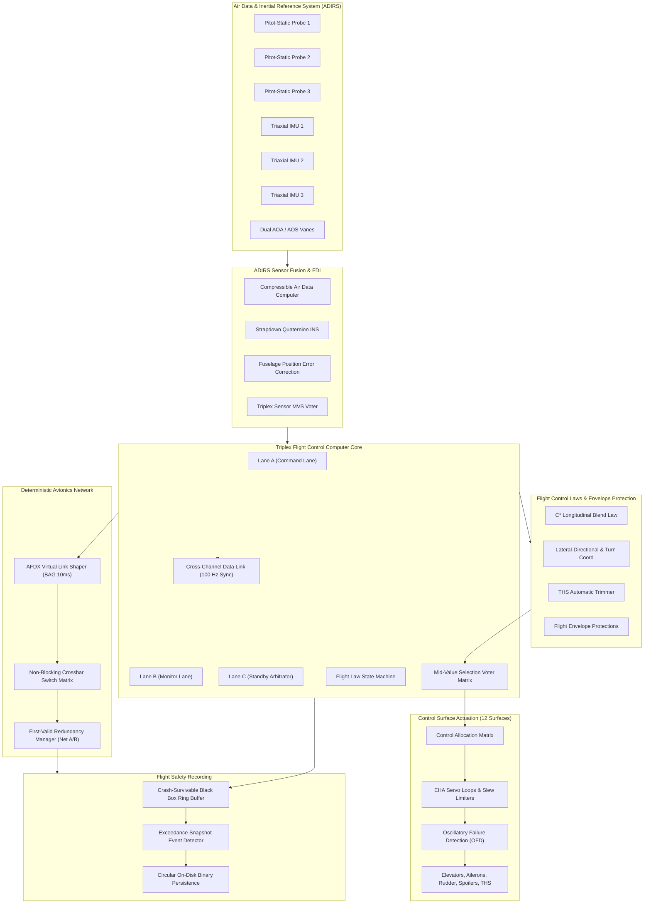
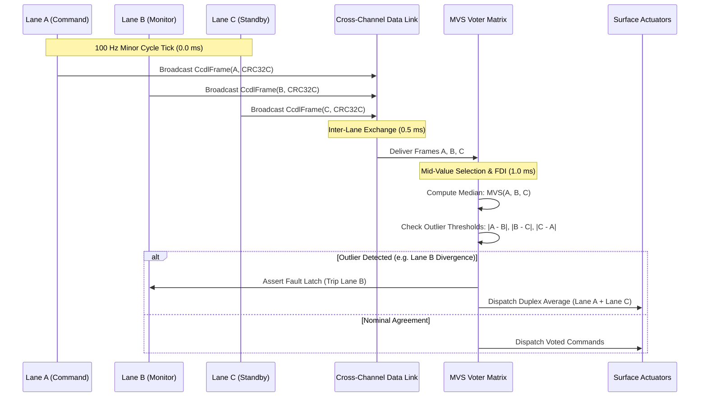
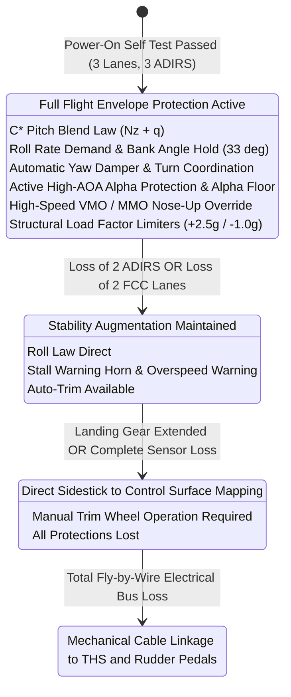
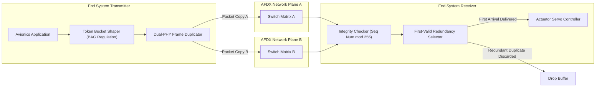

# Elevon Architecture Specification

## 1. System Overview

**Elevon** is a deterministic, safety-critical Fly-by-Wire (FBW) Primary Flight Control Computer (FCC) and ARINC 664 Part 7 (AFDX) avionics network engine. Engineered in **Cangjie** with zero-cost **C17** hardware acceleration, Elevon coordinates triple-modular redundant (TMR) computational lanes, compressible flow air data estimation (ADIRS), and dynamic flight envelope protection laws.

The architecture strictly follows civil transport category requirements (FAA 14 CFR Part 25 / EASA CS-25) and DO-178C Level A / ARP4754A design assurance guidelines.

---

## 2. High-Level Subsystem Topology

---

## 3. Triple-Modular Redundancy (TMR) Voting Architecture

Elevon employs three independent hardware-isolated execution lanes (Lane A, Lane B, Lane C). Each lane executes identical flight control algorithms on a synchronized 100 Hz (10 ms) minor cycle.

---

## 4. Flight Control Law State Transitions

---

## 5. ARINC 664 (AFDX) Redundancy Management

Every avionics Ethernet frame is duplicated across two completely independent physical network planes (Network A and Network B). Receivers employ First-Valid sequence number acceptance to ensure zero packet loss during physical cable cuts or switch reboots.

